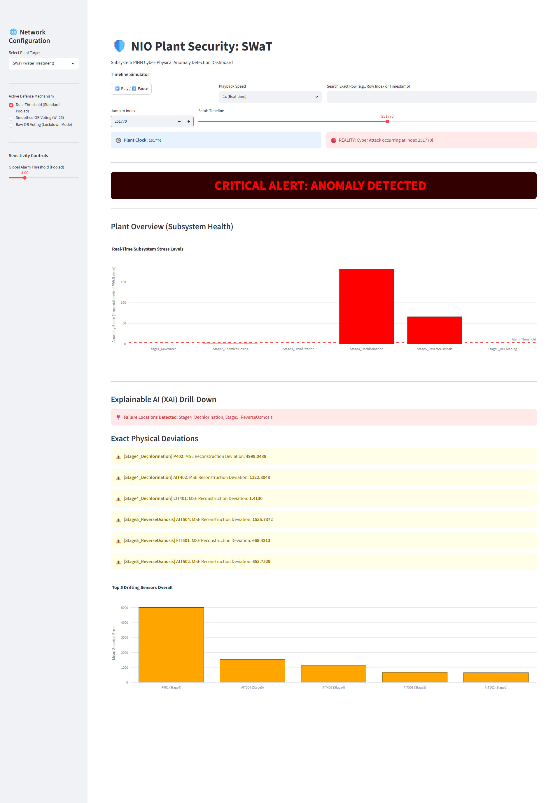
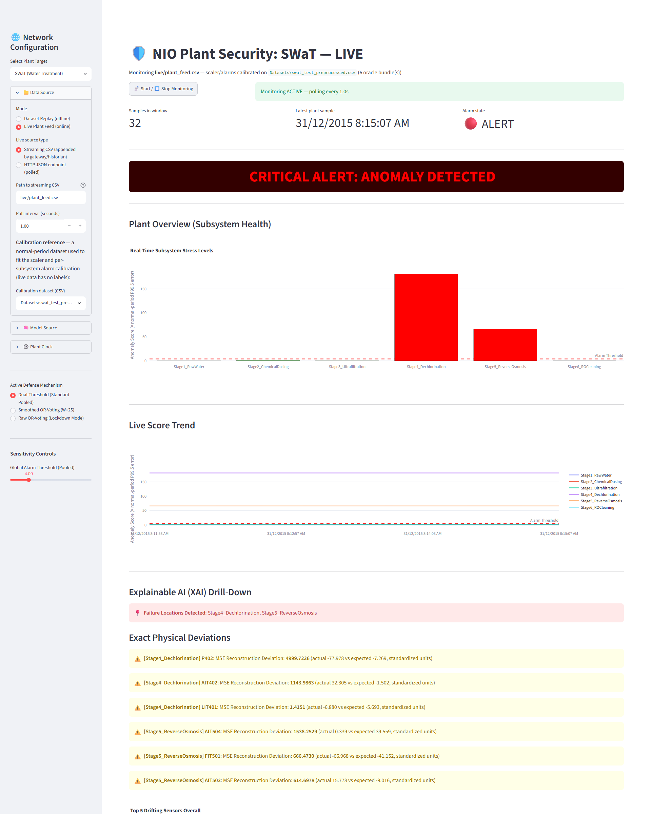

# PIVOT — Physics-Informed Voting Over Subsystems for Cyber-Physical Systems

**A localized Physics-Informed (PINN) subsystem array with OR-voting for anomaly/intrusion
detection in Industrial Control Systems (ICS/SCADA).**

A monolithic deep detector scores the whole plant against one global reconstruction
threshold, and that single view *dilutes* a localized attack: a fault confined to a handful
of sensors barely moves a whole-plant error, so it can slip through. PIVOT instead decomposes
the plant into its physical stages, trains one physics-informed autoencoder per stage, and
raises an alarm whenever **any** stage's detector fires (OR-voting). Undoing that signal
dilution is what makes the difference:

- **Clean detection improves** over the best monolithic model (SWaT F1 0.787 → 0.834 at a
  0.20% false-alarm rate).
- **Every alarm is explainable** — an XAI layer traces it to the exact stage and sensor that
  drifted, which also surfaced **273 mislabeled events** in the official SWaT ground truth.
- **Robustness is honest, not heroic** — under bounded, *non-adaptive* white-box evasion
  (PGD / APGD / C&W) the decomposed array degrades **gracefully** where a monolithic one-class
  baseline collapses. Adaptive, physics-aware attackers are explicitly left to future work.



---

## Headline results

On clean data the subsystem array beats the best monolithic detector; under bounded,
non-adaptive evasion it degrades gracefully instead of collapsing. All SWaT numbers use a
point-wise (no point-adjustment) protocol — train on normal-only data, evaluate on the
labeled attack+normal set.

**Clean detection — the primary result.** The production operating point (dual-threshold
with a W=25 temporal-persistence window) reaches **F1 83.35%, Precision 98.04%, FAR 0.20%**,
a **+4.62-point absolute F1** gain over the best monolithic model (Standard AE, F1 78.73%).
Removing the whole-plant *signal dilution* is what buys it: a localized attack that barely
moves a global reconstruction error clearly trips the one stage it actually touches.

**Robustness — a secondary, honest result (graceful degradation, not immunity).** Under
white-box PGD / APGD / C&W at ε=0.1, evaluated *non-adaptively* (the attacker does not know
the OR-vote), the array's recall slips ~3 points while a monolithic Deep SVDD detector
collapses:

| Model under ε=0.1 evasion | Clean recall | Adversarial recall | Δ |
|---|---|---|---|
| Monolithic Deep SVDD | 0.92 | **0.36** | −0.56 (collapse) |
| Monolithic Standard AE | 0.62 | 0.62 | ≈0 |
| **Subsystem array (dual-threshold)** | **0.725** | **0.696** | **−0.03 (graceful)** |

A bounded perturbation cannot push every small per-stage detector under its threshold at
once, so recall holds up — but we make **no claim of adversarial immunity**: an *adaptive*
attacker who optimizes directly against the OR-vote is out of scope here and left to future
work.

Two further results round out the picture:

- Correcting SWaT labels for physical recovery windows lifts precision to **99.79%** and
  cuts the false-alarm rate to **0.020%** (419 → 77 false positives); the physics view also
  exposed **273 mislabeled events** in the official labels.
- A controlled physics-coverage ablation shows physical invariants act as a
  **false-alarm lever on strong baselines** (SWaT: ~10% relative FAR reduction at equal F1)
  and a **recall/robustness lever on weak ones** (WADI: adversarial recall doubled;
  HAI: +38% relative F1 at flat FAR).

Full consolidated findings: [`docs/RESEARCH_FINDINGS.md`](docs/RESEARCH_FINDINGS.md) ·
detailed experiment comparison: [`results/experiments_comparison.md`](results/experiments_comparison.md) ·
raw benchmark CSVs: [`results/`](results/).

---

## Reproducibility

The clean-data headline (**Subsystem AE, dual-threshold, point-wise: F1 83.35%,
precision 98.04%, recall 72.49%, FAR 0.20%** — the shipped seed-4 run) is a *single
training run*. Training is
stochastic, so we also report the spread across five independently seeded runs of the same
configuration — train on `swat_train_preprocessed.csv` (normal only), evaluate the
dual-threshold + temporal-persistence protocol (W=25) on `swat_test_preprocessed.csv`:

| Seed | F1 | Precision | Recall | FAR |
|---|---|---|---|---|
| 1 | 83.97% | 97.81% | 73.56% | 0.23% |
| 2 | 83.62% | 91.40% | 77.06% | 1.00% |
| 3 | 83.87% | 97.39% | 73.65% | 0.27% |
| **4 (shipped)** | **83.35%** | **98.04%** | **72.49%** | **0.20%** |
| 5 | 83.69% | 91.68% | 76.98% | 0.97% |
| **mean ± sd** | **83.70 ± 0.24%** | 95.26 ± 3.41% | 74.75 ± 2.12% | 0.53 ± 0.41% |

The published figure sits inside this distribution. **Cite the mean ± sd, not a single run.**
Per-seed metrics: [`results/paper_reproducibility_swat.csv`](results/paper_reproducibility_swat.csv).
Per-seed model bundles: [`Oracles/swat_seeds/`](Oracles/swat_seeds/) (1.3 MB) — so the table
above can be checked without retraining.

Reproduce it yourself (each seed writes six subsystem bundles):

```bash
python run_generalized_subsystems.py --dataset swat --train --seed 4
python run_generalized_subsystems.py --dataset swat --eval
```

Baseline comparisons (USAD, GDN), the adversarial-robustness reproduction, and the
multi-seed check are documented in [`BASELINES.md`](BASELINES.md).

**Two corrections applied after the paper was submitted** (both affect the pretrained bundles,
not the method or its conclusions):

1. **Feature expansion.** Preprocessing one-hot-encodes the valve actuators (`MV101` →
   `MV101_0/1/2`), but training matched feature names literally, so **every valve was silently
   dropped** from the models. Fixed in `expand_features()`; the shipped bundles now include the
   actuator states the physics invariants depend on. With the fix, mean F1 rises from
   82.61% to 83.70%.
2. **Bundle provenance.** The bundles previously shipped in `Oracles/` were overwritten by the
   physics-coverage ablation's treatment arm (they scored F1 77.3% / recall 63.7%, not the
   headline numbers). `Oracles/subsystem_*.pth` now holds the seed-4 headline models.

Training seeds now pin weight init, batch shuffling, and the train/val split (`--seed`). Note
that a single run of the paper's *lockdown* OR-voting operating point is higher-variance than
the dual-threshold point reported above.

---

## Repository layout

```
├── PIVOT_Oracle_Training.py              # Phase 1: train monolithic oracles (AE/DAE/SVDD/VAE/Contrastive/Transformer)
├── PIVOT_Oracle_Evaluation.py            # Phase 1: evaluate a trained oracle (type auto-detected from the .pth bundle)
├── PIVOT_Adversarial_Evaluation.py       # Phase 2: white-box PGD evasion against monolithic oracles
├── run_subsystem_experiments.py        # Phase 3: SWaT subsystem PINN array + voting protocols (config at top of file)
├── run_preprocessed_subsystem_experiments.py  # Phase 3: physics-coverage ablation on preprocessed SWaT
├── run_generalized_subsystems.py       # Phase 3: dataset-agnostic subsystem array (SWaT/WADI/HAI, CLI-driven)
├── run_subsystem_adversarial.py        # Phase 3: adversarial evaluation of the subsystem array
├── run_batch_adversarial.py            # Batch PGD benchmark across oracles
├── PIVOT_Phase4_XAI_Visualization.py     # Phase 4: reconstruction-error heatmaps / XAI (SWaT)
├── PIVOT_Phase5_WADI_HAI_XAI.py          # Phase 5: XAI for WADI & HAI
├── generate_mislabeled_report.py       # 273 mislabeled-events analysis (physics vs. official labels)
├── run_gnn_experiments.py              # ST-GAE graph-autoencoder baseline (SWaT)
├── preprocess_swat.py / preprocess_wadi.py / preprocess_hai.py / preprocess_network.py
├── merge_datasets.py                   # dataset merging utilities
├── hai_*.py / wadi_*.py                # HAI/WADI feature engineering, subsystem & GNN variants
├── *_global_baselines*.py             # global (monolithic) baseline train/eval
├── PIVOT_Advanced_Metrics_Eval*.py       # advanced metrics (subsystem & monolithic)
├── PIVOT_SCADA_Dashboard.py              # interactive SCADA/HMI Streamlit dashboard (replay + live feed)
├── simulate_live_feed.py               # replays a dataset CSV as a growing "live" feed for the dashboard
├── PIVOT_Phase5_Train_Dashboard_Oracles.py
├── Datasets/                           # subsystem decompositions + preprocessing metadata (JSON only —
│                                       #   preprocessed CSVs are generated locally and git-ignored)
├── Oracles/                            # 13 pretrained per-subsystem PINN autoencoder bundles (SWaT/WADI/HAI)
├── SWaT_Orig_DataSets/                 # ← place the raw datasets here (empty in git; see below)
├── results/                            # benchmark result CSVs + experiment comparison
├── docs/                               # consolidated findings, XAI heatmaps, dashboard screenshot
└── requirements.txt
```

---

## Setup

Python **3.11** with PyTorch (CUDA used automatically when available):

```bash
conda create -p ./env python=3.11
conda activate ./env
pip install -r requirements.txt
# For GPU training, install the CUDA build of PyTorch instead, e.g.:
# pip install torch==2.5.1 --index-url https://download.pytorch.org/whl/cu121
```

Run all scripts **from the repository root**.

---

## Datasets (not included — obtain from the official sources)

The benchmark datasets are **license-restricted and are not redistributed in this
repository**. Request/download them from their owners:

| Dataset | Owner / official source | What to request |
|---|---|---|
| **SWaT** (Secure Water Treatment) | [iTrust, Centre for Research in Cyber Security, SUTD](https://itrust.sutd.edu.sg/itrust-labs_datasets/) | SWaT.A1 & A2 (Dec 2015): `SWaT_Dataset_Normal_v1`, `SWaT_Dataset_Attack_v0` |
| **WADI** (Water Distribution) | [iTrust, Centre for Research in Cyber Security, SUTD](https://itrust.sutd.edu.sg/itrust-labs_datasets/) | WADI.A1: `WADI_14days`, `WADI_attackdata` |
| **HAI** (HIL-based Augmented ICS) | [github.com/icsdataset/hai](https://github.com/icsdataset/hai) | HAI 23.05: `hai-train1..4`, `hai-test1..2`, `label-test1..2` |

After obtaining them, place the CSV exports as follows (paths expected by the
preprocessing scripts):

```
SWaT_Orig_DataSets/
├── SWaT_Dataset_Normal_v1.csv
├── SWaT_Dataset_Attack_v0.csv
├── wadi/
│   ├── WADI_14days.csv
│   └── WADI_attackdata.csv
└── hai/hai-23.05/
    ├── hai-train1.csv … hai-train4.csv
    ├── hai-test1.csv, hai-test2.csv
    └── label-test1.csv, label-test2.csv
```

Then generate the preprocessed CSVs into `Datasets/` (they stay local — `.gitignore`
blocks every dataset CSV from being committed):

```bash
python preprocess_swat.py                 # → Datasets/swat_train_preprocessed.csv, swat_test_preprocessed.csv
python preprocess_wadi.py                 # → Datasets/wadi_train_preprocessed.csv, wadi_test_preprocessed.csv
python preprocess_hai.py                  # → Datasets/hai_train_preprocessed.csv,  hai_test_preprocessed.csv
python hai_feature_engineering.py         # optional: engineered HAI features
```

The label column is `Normal/Attack`. Convention throughout the repo: **train on
normal-only data, evaluate on labeled attack+normal data.**

---

## How to run the pipeline

### Phase 1 — Monolithic oracles (baselines)

Train an unsupervised "oracle" on normal-only data (`--type` selects the architecture;
`dae` is `standard` plus input noise):

```bash
python PIVOT_Oracle_Training.py --type standard --data "Datasets/swat_train_preprocessed.csv" --output "Oracles/standard_model.pth"
python PIVOT_Oracle_Training.py --type svdd     --data "Datasets/swat_train_preprocessed.csv" --output "Oracles/svdd_model.pth"
# types: standard | dae | svdd | vae | contrastive | transformer
# extras: --bottleneck 32  --scaler {minmax|zscore}  --epochs 300  --patience 30  --noise  --batch_size 256
```

Evaluate — the `.pth` bundle is self-describing (stores `model_type`, scaler stats, SVDD
center, …), so **no model-type flag is needed**:

```bash
python PIVOT_Oracle_Evaluation.py --model "Oracles/standard_model.pth" --data "Datasets/swat_test_preprocessed.csv"
# extras: --threshold_mode {f1_opt|train_p95|train_p99}  --window_size N  --error_mode {mean|max}
```

### Phase 2 — Break the monoliths (white-box adversarial evasion)

```bash
python PIVOT_Adversarial_Evaluation.py --model "Oracles/standard_model.pth" \
  --data "Datasets/swat_test_preprocessed.csv" --run_adversarial --epsilon 0.1 --alpha 0.02 --num_iter 10
python run_batch_adversarial.py     # batch PGD benchmark across all oracles → results CSV
```

### Phase 3 — The subsystem PINN array (the novel contribution)

One autoencoder per physical subsystem (SWaT = 6 plant stages, WADI = 3, HAI = 4; the
decompositions live in `Datasets/*_subsystems.json`), each trained with a physics-informed
loss term (`lambda_phys`, mass-balance / actuator→flow invariants) on top of
reconstruction MSE, combined by OR-voting / dual-threshold protocols:

```bash
# Dataset-agnostic runner (recommended) — reads Datasets/<dataset>_subsystems.json
python run_generalized_subsystems.py --dataset swat --train --eval --adversarial
python run_generalized_subsystems.py --dataset wadi --train --eval --adversarial
python run_generalized_subsystems.py --dataset hai  --train --eval --adversarial

# SWaT-specific runner with all voting protocols (OR / CUSUM / selective-OR / dual-threshold)
# — configuration is edited at the top of the file (TRAIN_MODELS, AGGREGATION_MODE, WINDOW_SIZE=25)
python run_subsystem_experiments.py

# Physics-coverage ablation (3-stage vs 6-stage invariants, ENABLE_STAGE456_PHYS toggle)
python run_preprocessed_subsystem_experiments.py

# Adversarial evaluation of the subsystem array
python run_subsystem_adversarial.py
```

The `WINDOW_SIZE = 25` temporal-persistence window is a deliberate design choice: it
smooths high-frequency mechanical noise to suppress false positives while keeping
detection latency physically negligible.

### Phase 4/5 — XAI & the mislabeled-events analysis

```bash
python PIVOT_Phase4_XAI_Visualization.py      # SWaT reconstruction-error heatmaps
python PIVOT_Phase5_WADI_HAI_XAI.py           # WADI & HAI heatmaps (see docs/*_xai_heatmap.png)
python generate_mislabeled_report.py        # 273 mislabeled SWaT events report
```

### Baselines & GNN comparison

```bash
python train_global_baselines_generalized.py
python evaluate_global_baselines_generalized.py
python run_gnn_experiments.py --train --seq_len 10        # ST-GAE cyber-physical graph AE
```

### Interactive SCADA dashboard

An operator-style HMI over the pretrained subsystem array with switchable defense
mechanisms (dual-threshold / smoothed OR-voting / raw OR-voting lockdown), live
per-subsystem stress levels, and an XAI drill-down that names the exact drifting sensors
with actual-vs-expected values (see the screenshot at the top of this README — a true SWaT
attack where Stage 4 Dechlorination and Stage 5 Reverse Osmosis both fire, localized down
to `P402`/`AIT402`):

```bash
streamlit run PIVOT_SCADA_Dashboard.py
```

Everything is selectable from the sidebar:

- **📁 Data Source** — two modes:
  - **Dataset Replay (offline)**: pick any CSV in `Datasets/` (or type a custom path) and
    scrub/play through its timeline with ground-truth attack banners.
  - **Live Plant Feed (online)**: monitor a **streaming CSV** that a gateway/historian
    appends to, or poll an **HTTP JSON endpoint** returning the newest sample(s). Because
    live data has no labels, you pick a **calibration reference dataset** (a normal-period
    CSV) used to fit the scaler and the per-subsystem alarm calibration. The live view adds
    a rolling per-subsystem score trend. Demo it without a plant:

    ```bash
    # terminal 1 — replay the SWaT test set into a growing "live" CSV at 5 samples/s
    python simulate_live_feed.py --source Datasets/swat_test_preprocessed.csv \
        --out live/plant_feed.csv --rate 5 --start-row 251000
    # terminal 2 (or the sidebar): Live Plant Feed -> Streaming CSV -> live/plant_feed.csv -> Start
    ```

- **🧠 Model Source** — choose the oracle-bundle directory, filename prefix, and exactly
  which per-subsystem `.pth` bundles to load (defaults to the 13 shipped pretrained ones:
  SWaT ×6, WADI ×3, HAI ×4).
- **🕒 Plant Clock** — the dashboard shows the **actual timestamp column** next to the
  plant-clock index when the dataset has one (SWaT does); for datasets without one
  (WADI/HAI) it synthesizes a clock from a configurable plant start time + sample period,
  clearly marked *(synthesized)*.



Scoring: inputs are standardized against the reference dataset's normal-period statistics
(the `ALIGN_BASELINE` convention used by the research runners), and each subsystem's
anomaly score is its smoothed max reconstruction error **relative to that subsystem's
normal-period P99.5 error**, calibrated once at startup — so a score above the alarm
threshold means "several times worse than the normal period ever gets". First load of a
plant takes a minute or two (it reads a few-hundred-MB CSV and runs the calibration pass).
Replay CSVs are produced by the preprocessing scripts: `Datasets/swat_test_preprocessed.csv`
(from `preprocess_swat.py`), `Datasets/wadi_test_preprocessed.csv` (from
`preprocess_wadi.py`), `Datasets/hai_test_engineered.csv` (from `preprocess_hai.py` +
`hai_feature_engineering.py`).

---

## Findings summary

1. **Subsystem beats monolithic on clean data (the primary result).** Best config
   (dual-threshold, point-wise): **F1 83.35%, FAR 0.20%** — +4.62 F1 points over the best
   monolith; the PINN variant ties on F1 (83.35%) at a higher recall (75.15%) and FAR
   (0.71%). Undoing whole-plant signal dilution is the mechanism.
2. **Graceful robustness — a secondary result, not immunity.** Under bounded, *non-adaptive*
   white-box PGD/APGD/C&W at ε=0.1, monolithic detectors stay capped (~0.62 recall) or
   collapse (Deep SVDD 0.92 → 0.36), while the subsystem dual-threshold array loses under
   3 points (0.725 → 0.696). A small perturbation cannot slip every per-stage detector under
   threshold at once; we make **no claim of immunity** against an adaptive attacker who
   targets the OR-vote directly — that is explicitly future work.
3. **Dual-threshold + temporal persistence** catches both spikes (high threshold, instant)
   and slow persistent attacks (low threshold sustained 200+ samples, W=25).
4. **Physics catches labeling errors.** Physics-corrected labels: precision 98.84% → 99.79%,
   FAR 0.106% → 0.020%; the 77 remaining "false" positives are almost entirely rare
   maintenance cycles the model correctly flags.
5. **Physics-coverage ablation.** On strong baselines (SWaT), invariants are a
   *false-alarm lever* (~10% relative FAR cut at equal F1); on weak baselines (WADI/HAI),
   they are a *recall & robustness lever* (WADI adversarial recall doubled; HAI +38%
   relative F1 at flat FAR). **The weaker the data-driven baseline, the more physics
   contributes.**
6. **Open gaps.** WADI/HAI absolute performance (F1 ≈ 0.25–0.31) remains the primary open
   problem; the GNN (ST-GAE) baseline is competitive (F1 ~82%) but does not surpass the
   subsystem array.

---

## Citation

A paper on this work is in preparation. Until it is published, please cite this
repository:

```bibtex
@misc{pivot2026,
  author = {Sumendra B. Singh},
  title  = {PIVOT: Physics-Informed Voting Over Subsystems for Interpretable
            Anomaly Detection in Industrial Cyber-Physical Systems},
  year   = {2026},
  url    = {https://github.com/sumendrabsingh/PIVOT-Anomaly-Detection-CPS},
  doi    = {10.5281/zenodo.21682294}
}
```

**Dataset credits:** SWaT and WADI are provided by iTrust, Centre for Research in Cyber
Security, Singapore University of Technology and Design. HAI is provided by the National
Security Research Institute (NSR), South Korea. Use of those datasets is governed by their
owners' terms; this repository contains no dataset data.

## License

Copyright (c) 2026 Sumendra B. Singh. **All rights reserved.**

This repository is published for **academic reproducibility only**: you may view,
download, and run the code to verify or reproduce the published results and for
non-commercial academic research, with citation. Commercial use, redistribution,
or incorporation into other software requires prior written permission — see
[LICENSE](LICENSE).

An archived, citable version of this repository is deposited on Zenodo:
[](https://doi.org/10.5281/zenodo.21682294)
